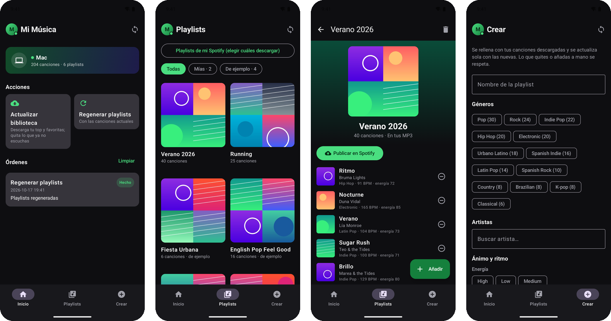
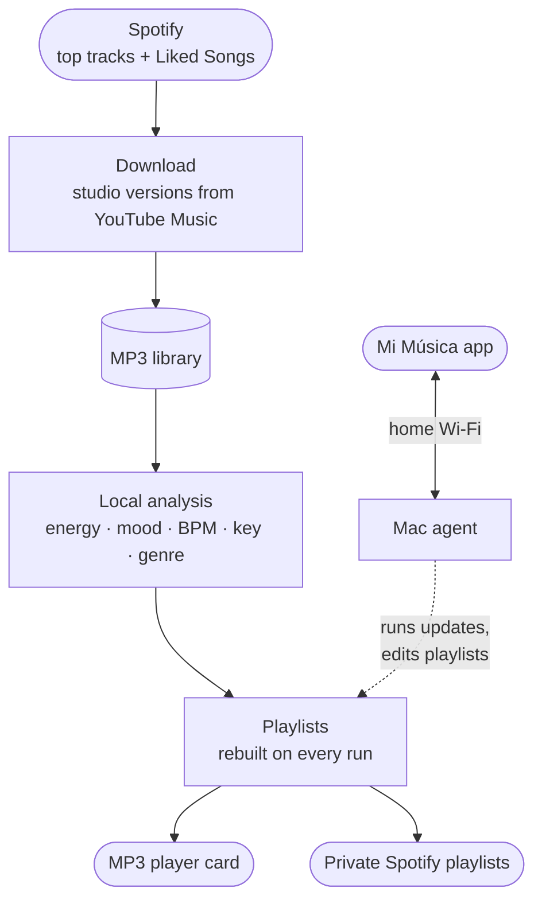

# spot-mp3

Keep a basic MP3 player in step with what you listen to on Spotify. Your Mac downloads the songs,
analyses each one (energy, mood, tempo, key, genre), sorts them into playlists that update
themselves and syncs them to the player. **Mi Música**, an Android app, controls it all from your
phone over the home Wi-Fi.


*The phone app on invented demo data: home, playlists, a playlist and the playlist creator.*

> **Status:** works on **macOS** with the **Android** app. An iPhone app and Windows support
> are not built yet.

> **Disclaimer — use at your own risk.** This project downloads audio from YouTube through
> [spotDL](https://github.com/spotDL/spotify-downloader). Downloading copyrighted music without
> the rights holder's permission may be illegal where you live and is against YouTube's Terms of
> Service. Only use it for content you are allowed to download. It is a personal, non-commercial
> project, provided "as is", without warranty of any kind, and not affiliated with or endorsed
> by Spotify, YouTube or the Essentia project. You are solely responsible for how you use it.

Program output and the phone app's screens are in Spanish; code, comments and docs are in English.

## Why
Some days you want to leave the phone at home, for a run or just to switch off, and still have
the songs you are listening to right now. A small MP3 player covers that as long as it stays up to
date, and copying music over by hand is a job that keeps getting put off. spot-mp3 does it for
you: what you play and like on Spotify ends up on the player, and what you stop listening to drops
off. It also builds playlists from audio features, like "Running" with everything above 140 BPM
or an upbeat "Verano 2026", and you can adjust them from your phone.

## What it does
- **Library from your listening**: your top tracks and Liked Songs, downloaded as the official
  studio version; songs you stop listening to are retired.
- **Local audio analysis**: energy, danceability, mood, tempo, key and genre for every song.
- **Living playlists**: defined by criteria and refreshed with new songs on every run; publish
  them to Spotify as private playlists if you like.
- **MP3 player sync**: the player's card is updated when you plug it in, with even loudness.
- **Phone app**: browse, edit and create playlists, review doubtful song versions, and start
  updates; orders made while the Mac is asleep run when it is back.

## Getting started
You need a Mac, Python 3.10+ (plus Python 3.10 exactly for the audio analysis;
[uv](https://docs.astral.sh/uv/) makes that easy), a Spotify account and, for the app, an
Android phone and the Android SDK with JDK 21.

**1. Install** (from the project folder; ~40 MB of models go to `models/`):

```bash
python3 -m venv .venv
.venv/bin/python -m pip install -r requirements.txt
.venv/bin/spotdl --download-ffmpeg
uv venv --python 3.10 .venv-essentia
uv pip install --python .venv-essentia/bin/python -r requirements-essentia.txt
bash scripts/download_models.sh
```

**2. Connect Spotify.** In the [Spotify developer dashboard](https://developer.spotify.com/dashboard),
create an app with the Web API and the redirect URI `http://127.0.0.1:8888/callback`, and add
your account under *User Management*. Copy its **Client ID** into `config.env` (no Client Secret
is needed):

```bash
cp config.example.env config.env
```

**3. First run.** The first export opens the browser to approve access; after that the login
renews itself. The first full run downloads and analyses your whole library, so it takes a while.

```bash
cd scripts && ../.venv/bin/python spotify_export.py
./runner.sh
```

**4. Phone app.** Install the Mac agent (it starts at login) and build the app:

```bash
../.venv/bin/python agent_server.py --install
cd ../android && ./gradlew assembleRelease
```

Install `android/app/build/outputs/apk/release/app-release.apk` on the phone. Then in the app:
Ajustes > "Pedir código al Mac"; the code appears in a Mac notification.

<details>
<summary>Signing with your own key</summary>

By default the APK is signed with your debug key. To use your own, create a key (back it up with
its password) and point `android/keystore.properties` to it:

```bash
keytool -genkeypair -keystore ~/mimusica-release.jks -storetype PKCS12 -alias mimusica -keyalg RSA -keysize 4096 -validity 10000
```

```properties
storeFile=/Users/<you>/mimusica-release.jks
storePassword=<password>
keyAlias=mimusica
keyPassword=<password>
```
</details>

Optional: to set genres yourself, copy `data/artist_genres.example.csv` to
`data/artist_genres.csv` and add one `artist;genre` line per artist.

## How it works



`scripts/runner.sh` runs the whole chain; `scripts/agent_server.py` is the Mac agent the phone
talks to.

- **Python** scripts: spotipy, spotDL, ytmusicapi, pandas, mutagen; FastAPI and zeroconf for the
  agent; `launchd` keeps the agent and the player sync running.
- **Essentia** pretrained models for the audio analysis, in their own environment.
- **Android app**: Kotlin and Jetpack Compose.
- **Plain files instead of a database**: a CSV library, `.m3u8` playlists that any player opens,
  and JSON state.

## Technical decisions
- **The studio track, not a live video.** Downloads look for the official studio track on
  YouTube Music and skip live, karaoke or cover versions. A later check swaps any that slipped
  through; doubtful matches wait for you to listen and decide from the phone.
- **Audio features without Spotify.** Spotify no longer shares audio features with new apps, so
  every song is measured locally with Essentia's models. Tempo agreed with Spotify's more often
  than with librosa in our tests. Low / Medium / High are relative to your own library: "high
  energy" means high for what you listen to.
- **Genre per artist, for now.** Your own `artist;genre` table wins; otherwise the genre is
  guessed from the artist's country (MusicBrainz), the language of the titles and the sound
  Essentia hears. Genres per song are a possible next step.
- **Lossless loudness.** Like mp3gain, the volume is evened out without re-encoding, works on any
  player and can be undone.
- **Playlists as saved queries.** New matching songs come in by themselves; songs you remove by
  hand never come back, and songs you add stay.
- **Cleanup that can't wipe the library.** Songs leave only after a fresh export, never too many
  at once, and through a 7-day trash. To keep a song, save it to Liked Songs.
- **Offline-first app, secure pairing.** The phone works with its last copy and queues orders
  for the Mac. Pairing needs a code shown on the Mac, and the agent only answers on the home
  network.

## Everyday use
From `scripts/`, with the main environment active (`source ../.venv/bin/activate`). The
scripts that change files (`library_cleanup.py`, `version_audit.py`, `loudness.py`,
`spotify_upload.py`, `mp3_export.py`) accept `--dry-run` to see what they would do.

| Command | What it does |
|---|---|
| `./runner.sh` | Updates everything: export, cleanup, downloads, versions, loudness, analysis, playlists, MP3 export. Exit code 2 = Spotify needs a login (run `python spotify_export.py` once) |
| `python version_review.py` | Review doubtful song versions: listen, approve or remove (also from the app) |
| `python playlist_builder.py "<name>"` | Build one example playlist (no name = list them, `--all` = all) |
| `python spotify_upload.py "<name>"` | Publish a playlist to Spotify as private |
| `python spotify_playlists.py` | List your own Spotify playlists; `--download <id>` adds one to the library |
| `python mp3_export.py --card "/Volumes/<CARD>"` | Sync the player's card by hand |
| `python mp3_autosync.py --install` | Sync automatically when the player is plugged in (asks first) |
| `python agent_server.py --unblock` | Lift pairing blocks after too many wrong codes |

**Your own playlists.** Create them from the app, or add them to `PRESETS` in
`playlist_builder.py`:

```python
"Running": {
    "criteria": {"energy_group": "High", "bpm_exact_min": 140},
    "limit": 40,
    "order_by": "bpm_exact",
},
```

Criteria: `genre`, `genre_family`, `genre_not`, `energy_group` / `danceability_group`
(Low, Medium, High), `valence_group` (Dark/Sad, Neutral, Happy/Upbeat), `mode` (major, minor),
numeric limits such as `energy_min` or `bpm_exact_max` (0-100; BPM), and numeric targets such as
`valence: 30` (closest songs first).

**MP3 player.** `MP3 Player Card/` holds every MP3 with plain file names and one `.m3u` per
playlist, ready for the root of the card. Built for a Yoton YM03; similar basic players should
work.

## Privacy
Everything personal stays on your Mac and is ignored by git: `config.env`, `data/` (library,
listening data, reviews, the Spotify login and phone tokens), the music, playlists and logs.
Nothing is sent anywhere except the requests to Spotify, YouTube Music, MusicBrainz and
ReccoBeats needed to build the library. The screenshots above use invented demo data.

## License
[MIT](LICENSE) for this project's code. Third-party components keep their own licenses:
[spotDL](https://github.com/spotDL/spotify-downloader) (MIT),
[spotipy](https://github.com/spotipy-dev/spotipy) (MIT),
[ytmusicapi](https://github.com/sigma67/ytmusicapi) (MIT) and
[Essentia](https://essentia.upf.edu) (AGPL-3.0). The Essentia models downloaded by
`download_models.sh` are licensed by the Music Technology Group (UPF) for **non-commercial use**
(CC BY-NC-SA 4.0); see their site for terms.
